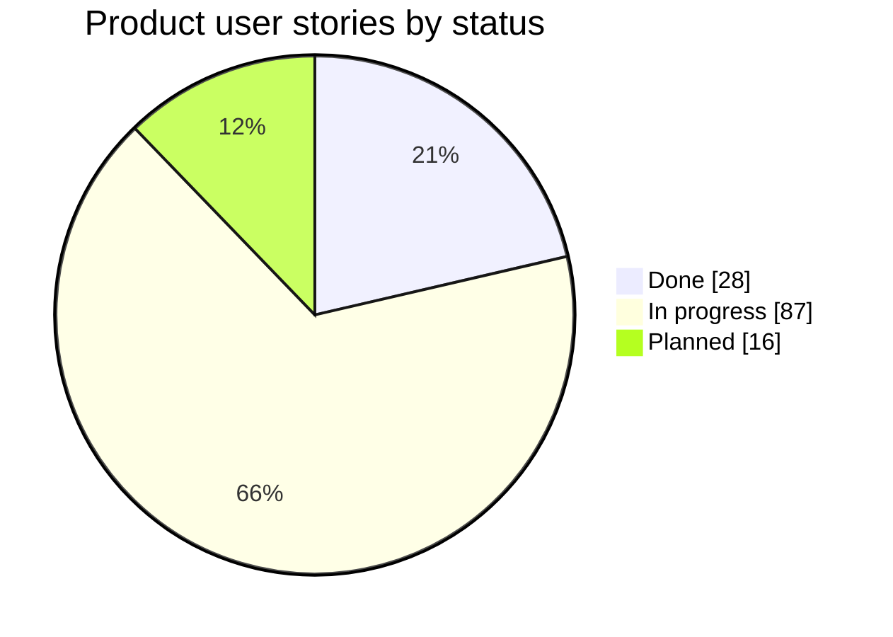
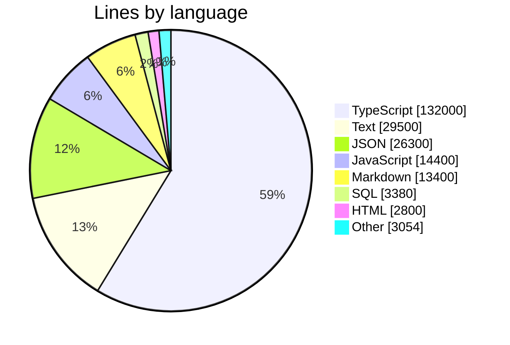
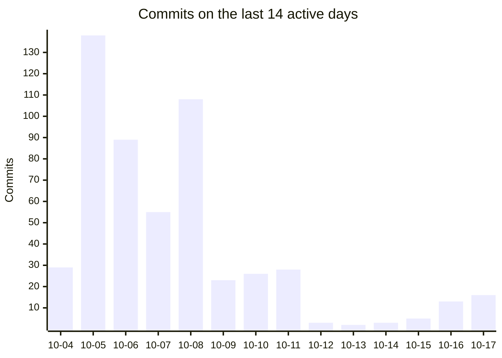

# PflanzenDex

A multi-user, mobile-first web app (PWA) for houseplant collectors: a shared species catalog, your own specimens with light zones and care phases, growth tracking, treatments, a wishlist and a Pokédex of the species you have caught.

[Specs](docs/specs/product/readme.md) · [App code](docs/guides/reference/app.md) · [Contributing](CONTRIBUTING.md) · [Rules for AI agents](AGENTS.md)

<!-- repo-stats:start (generated by tools/repo/repo-stats.sh, do not edit by hand) -->

## What PflanzenDex does

The product is cut into 15 feature areas (epics): **1 complete, 14 in progress, 0 planned.** Each area links to its spec; progress counts user stories (█ done, ▒ in progress, ░ planned).

| Status | Area                                                                          | What it covers                                                                                            | Stories             | Progress     |
| :----: | ----------------------------------------------------------------------------- | --------------------------------------------------------------------------------------------------------- | ------------------- | ------------ |
|   ✅   | **Treatments** · [BEH](docs/specs/product/06-treatments.md)                   | Pests, diseases, courses of treatment                                                                     | 4 ✅ · 0 🟨 · 0 ⬜  | `██████████` |
|   🟨   | **Accounts** · [ACC](docs/specs/product/01-accounts-and-onboarding.md)        | Account, sign-in, profile, invitation                                                                     | 3 ✅ · 2 🟨 · 1 ⬜  | `█████▒▒▒░░` |
|   🟨   | **Collection** · [BES](docs/specs/product/02-collection.md)                   | Species catalog, enrichment from sources, corrections, care profile, review, specimens, cutting, archive  | 2 ✅ · 9 🟨 · 5 ⬜  | `█▒▒▒▒▒▒░░░` |
|   🟨   | **Light and locations** · [LIC](docs/specs/product/03-light-and-locations.md) | Light zones, locations, distribution, position                                                            | 3 ✅ · 2 🟨 · 0 ⬜  | `██████▒▒▒▒` |
|   🟨   | **Care phases** · [PHA](docs/specs/product/04-care-phases.md)                 | Dormancy/growth phase, location reconciliation                                                            | 2 ✅ · 2 🟨 · 0 ⬜  | `█████▒▒▒▒▒` |
|   🟨   | **Growth/photos** · [WAC](docs/specs/product/05-growth-and-photos.md)         | Measurement, trend, etiolation, photos                                                                    | 4 ✅ · 2 🟨 · 0 ⬜  | `███████▒▒▒` |
|   🟨   | **Wishlist** · [WUN](docs/specs/product/07-wishlist.md)                       | Purchase candidates, buffer, path to the plant                                                            | 0 ✅ · 5 🟨 · 0 ⬜  | `▒▒▒▒▒▒▒▒▒▒` |
|   🟨   | **Pokédex** · [POK](docs/specs/product/08-pokedex.md)                         | Collector cards, taxonomy, milestones                                                                     | 0 ✅ · 11 🟨 · 1 ⬜ | `▒▒▒▒▒▒▒▒▒░` |
|   🟨   | **Reminders/sensors** · [MON](docs/specs/product/09-reminders-and-sensors.md) | Notifications, watering, sensors                                                                          | 0 ✅ · 6 🟨 · 2 ⬜  | `▒▒▒▒▒▒▒▒░░` |
|   🟨   | **Social** · [SOZ](docs/specs/product/10-social.md)                           | Friends, feed, swapping                                                                                   | 3 ✅ · 10 🟨 · 0 ⬜ | `██▒▒▒▒▒▒▒▒` |
|   🟨   | **Equipment** · [EQU](docs/specs/product/11-equipment-and-recommendations.md) | Equipment, need, affiliate                                                                                | 0 ✅ · 11 🟨 · 1 ⬜ | `▒▒▒▒▒▒▒▒▒░` |
|   🟨   | **AI access** · [KI](docs/specs/product/12-ai-assistant.md)                   | AI access via an open interface, tasks, drafts, care by voice, profiles, photo assessment                 | 0 ✅ · 9 🟨 · 1 ⬜  | `▒▒▒▒▒▒▒▒▒░` |
|   🟨   | **Cross-cutting** · [QS](docs/specs/product/14-cross-cutting.md)              | Privacy, security, mobile, quality                                                                        | 0 ✅ · 10 🟨 · 4 ⬜ | `▒▒▒▒▒▒▒░░░` |
|   🟨   | **Discover** · [ENT](docs/specs/product/17-discover.md)                       | Swipe suggestions from the catalog, matching light and thriving plants, filling the wishlist              | 0 ✅ · 7 🟨 · 1 ⬜  | `▒▒▒▒▒▒▒▒▒░` |
|   🟨   | **Achievements** · [ACH](docs/specs/product/20-achievements.md)               | Achievements for care and growth, care rhythm, personal records, anniversaries, year in review, calm mode | 7 ✅ · 1 🟨 · 0 ⬜  | `█████████▒` |



## Engineering

|                     |                                                                       |
| ------------------- | --------------------------------------------------------------------- |
| **Repository**      | 2.16k files · 225k lines · 64 MiB                                     |
| **Production code** | 78.5k lines · packages: web 30.9k · core 20.3k · db 9.30k · api 6.42k |
| **Tests**           | 511 files · 4.38k test cases · 75.5k lines (96% of production code)   |
| **Database**        | 75 migrations · 103 error codes                                       |
| **Process docs**    | 14 ADRs · 9 agent skills · 5 runbooks                                 |

### Quality gates and development process

| Status | Area                                                                                         | What it covers                                                                      | Stories            | Progress     |
| :----: | -------------------------------------------------------------------------------------------- | ----------------------------------------------------------------------------------- | ------------------ | ------------ |
|   🟨   | **Quality gates** · [QG](docs/specs/product/18-architecture-and-quality-gates.md)            | Hooks, CI, structure rules, architecture boundaries, complexity, privacy gates, DoD | 0 ✅ · 7 🟨 · 2 ⬜ | `▒▒▒▒▒▒▒▒░░` |
|   🟨   | **Development process** · [DEV](docs/specs/product/19-development-process-and-automation.md) | Task runner, hooks, routines, skills, process, release, migrations, operations      | 1 ✅ · 9 🟨 · 2 ⬜ | `█▒▒▒▒▒▒▒░░` |



## Activity

768 commits by 4 people since 2026-10-02 · latest release `v0.0.0`



<sub>Generated by `tools/repo/repo-stats.sh` when a pull request is made ready (`make pr`, US-DEV-10). Code numbers come from the committed files, rounded to 3 significant digits; activity comes from `dev` up to this branch's base.</sub>

<!-- repo-stats:end -->

## Getting started

```bash
make setup   # install dependencies and git hooks
make dev     # start API and web
make ci      # all gates: lint, types, boundaries, format, tests, build
```

`make help` lists every task. Product rules, domain model and release cut start in [`docs/specs/product/readme.md`](docs/specs/product/readme.md).
