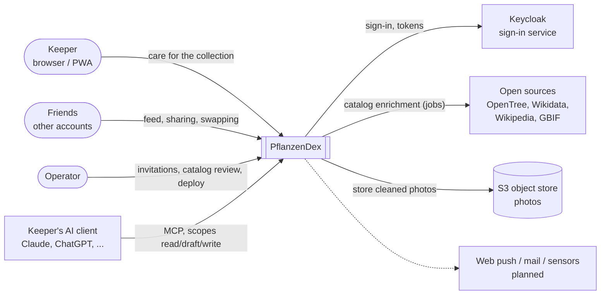
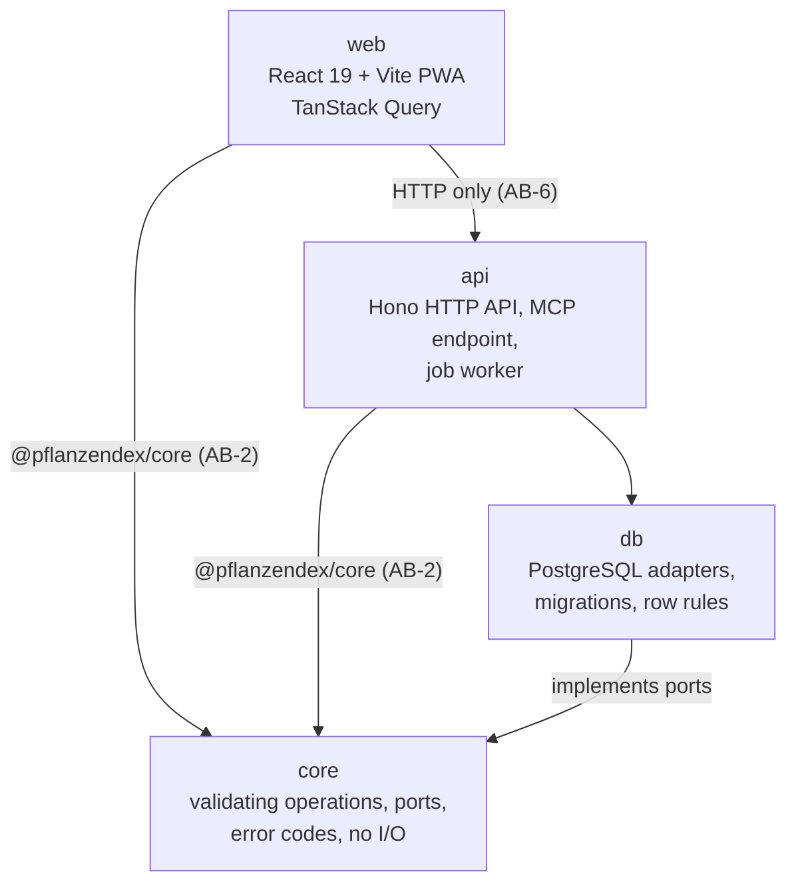
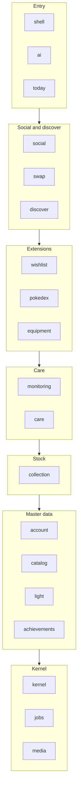
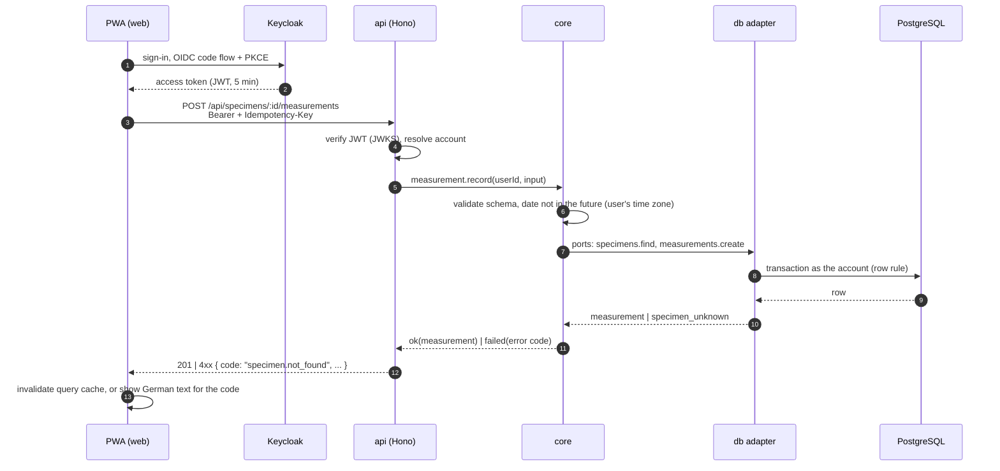
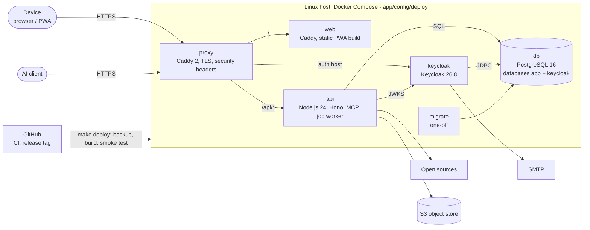

# Architecture documentation (arc42)

This document describes the architecture of the PflanzenDex web app along the twelve chapters of the [arc42](https://arc42.org) template. It is an entry point and a map: details live in the specs (`docs/specs/product/`), the decisions (`docs/adr/`, open decisions E-nn in `docs/specs/product/16-releases-and-decisions.md`) and the code reference (`docs/guides/reference/app.md`). Where this document and one of those sources differ, the source wins; fix this document in the same PR.

As of: 2026-11-03. Numbers (lines, tests, migrations) come from the repository statistics in `README.md` and are a snapshot.

## 1. Introduction and goals

### 1.1 Requirements overview

PflanzenDex is a multi-user, mobile-first web app (PWA) for houseplant collectors. It replaces a single-user prototype in an Obsidian vault (`docs/specs/prototype/`). Core functions, cut into epics (`docs/specs/product/readme.md`):

| Area                | Epics              | In short                                                                          |
| ------------------- | ------------------ | --------------------------------------------------------------------------------- |
| Collection          | ACC, BES, LIC, PHA | Accounts, shared species catalog, own specimens, light zones, care phases         |
| Growth and care     | WAC, BEH, MON      | Measurements and photos, growth trend and etiolation, treatments, reminders       |
| Collecting          | WUN, POK, ENT, ACH | Wishlist with buffer, Pokédex of caught species, discover, achievements           |
| Social              | SOZ                | Friends, sharing, feed, swapping of cuttings and plants                           |
| Extensions          | EQU, KI            | Equipment and labelled recommendations, AI access through the keeper's own client |
| Quality and process | QS, QG, DEV        | Privacy, security, accessibility, quality gates, development process              |

The release cut R0 (foundation) to R6 (sensors) is in `16-releases-and-decisions.md`.

### 1.2 Quality goals

The top quality goals, derived from the principles P-01 to P-11 (`00-product-overview.md`) and the non-functional requirements NFR-01 to NFR-18 (`14-cross-cutting.md`):

| Priority | Quality goal                     | Motivation                                                                                                |
| -------- | -------------------------------- | --------------------------------------------------------------------------------------------------------- |
| 1        | **Privacy and tenant isolation** | Locations, photos and living environment are sensitive. Private by default (P-04, P-05, NFR-09, NFR-11).  |
| 2        | **Correctness of derived data**  | Phases, trends and counts are computed by tested code, never invented (P-01, P-08, NFR-04, NFR-05).       |
| 3        | **Maintainability**              | A small team with AI agents develops fast; boundaries must hold by machine checks, not goodwill (E-20).   |
| 4        | **Usability on the phone**       | Measuring and moving happen next to the plant; every view says what to do (P-09, P-11, NFR-12, NFR-13).   |
| 5        | **Operability**                  | Self-hosted on one host by the team; backups, rollback and visible errors are mandatory (NFR-15, NFR-18). |

### 1.3 Stakeholders

| Role                  | Expectation                                                                                    |
| --------------------- | ---------------------------------------------------------------------------------------------- |
| Keeper (end user)     | Fast input on the phone, nothing lost, own data stays private                                  |
| Friends of a keeper   | See only what was shared; swapping that is fair to both sides                                  |
| Operator              | Simple operation on own hardware, invitations, catalog review, tested restore                  |
| Development team      | Clear module boundaries, executable specs, gates that stop mistakes early                      |
| AI agents in the repo | Unambiguous rules (`AGENTS.md`), playbooks (`.agents/skills/`), checks that cannot be bypassed |
| Keeper's AI client    | A stable, documented interface (MCP) with scopes; no hidden write paths                        |

## 2. Architecture constraints

| Constraint                  | Content                                                                                                            | Source                   |
| --------------------------- | ------------------------------------------------------------------------------------------------------------------ | ------------------------ |
| Language and stack          | TypeScript monorepo; PostgreSQL; React SPA with Vite                                                               | E-01, ADR 0006           |
| Modular monolith            | One deployable, one database, modules cut by domain with public interfaces                                         | E-20, ADR 0003           |
| Self-hosting in the EU      | One own host with Docker Compose; no rented provider for stage 1                                                   | E-01, R-09, R-11         |
| Sign-in not built ourselves | Keycloak, self-hosted, OIDC with PKCE; passwords never reach the app                                               | E-03, NFR-10             |
| No AI at the operator       | The app runs no model and holds no provider contract; AI comes from the keeper's own client over an open interface | E-04, P-01               |
| PWA first                   | Installable PWA; a native shell later only via Capacitor                                                           | E-06, E-21, ADR 0006     |
| Accessibility               | WCAG 2.2 AA as adopted by EN 301 549                                                                               | E-23, NFR-13             |
| Open data sources only      | Catalog data from OpenTree, Wikidata, Wikipedia, GBIF; throttled, cached, failure blocks nothing                   | E-25, NFR-17             |
| Public repository           | Rulesets, PR-only merges, green `ci-status`; agents merge into `dev` only via `make merge`                         | ADR 0001, ADR 0005, E-13 |
| English repository          | Code, docs, commits in English; only UI texts in German                                                            | ADR 0004                 |

## 3. System scope and context

### 3.1 Business context

| Neighbour       | Input to PflanzenDex                                | Output from PflanzenDex                         |
| --------------- | --------------------------------------------------- | ----------------------------------------------- |
| Keeper          | Specimens, measurements, photos, treatments, wishes | "Today" list, phases, trends, Pokédex, hints    |
| Friends         | Swap requests, answers, handover confirmations      | Shared collection parts, feed entries           |
| Operator        | Invitations, catalog reviews, feature switches      | Logs, failed jobs, backups                      |
| Keycloak        | Signed JWT access tokens, JWKS                      | Redirects (OIDC code flow), session revocation  |
| AI client       | Tool calls over MCP (read, drafts, writes by scope) | Results of the same domain operations as the UI |
| Open sources    | Taxonomy, names, images, occurrence data            | Throttled HTTP requests with a user agent       |
| S3 object store | Stored photo bytes                                  | Photos with EXIF/GPS removed                    |

### 3.2 Technical context

| Channel             | Protocol                                                              | Path                            |
| ------------------- | --------------------------------------------------------------------- | ------------------------------- |
| Browser to app      | HTTPS; static PWA and JSON API                                        | `/`, `/api/*` through the proxy |
| Browser to sign-in  | OIDC authorization code flow with PKCE                                | Auth host through the proxy     |
| API to Keycloak     | JWKS fetch for signature checks                                       | `OIDC_JWKS_URL` (internal)      |
| AI client to app    | MCP over streamable HTTP, OAuth 2 tokens with own audience (RFC 8707) | `/api/mcp`                      |
| API to open sources | HTTPS/JSON, throttled and cached                                      | background jobs                 |
| API to object store | S3 API                                                                | `S3_*` variables                |
| Keycloak to mail    | SMTP                                                                  | `SMTP_*` variables              |

## 4. Solution strategy

| Goal                               | Approach                                                                                                                                                               |
| ---------------------------------- | ---------------------------------------------------------------------------------------------------------------------------------------------------------------------- |
| Privacy and tenant isolation       | `account_id` on every user-owned row and a row rule in PostgreSQL (row level security via session variable); a tenant isolation test with two accounts for every table |
| Correct derived data               | Domain logic in `core` without I/O (AB-1); derived values computed live, never stored (NFR-04); acceptance criteria become tests named with the story ID (P-06)        |
| One logic for all interfaces       | Web, AI client and jobs call the same validating operations of `core` (P-02, P-03)                                                                                     |
| Maintainability under fast change  | Modular monolith with a dependency matrix as code; boundaries, file layout, complexity and file length are CI gates (FR-QG-19, FR-QG-21)                               |
| Predictable errors                 | Stable error codes `<domain>.<reason>` with German UI texts in `ERROR_TEXTS`; nothing swallowed (FR-QG-11, P-10)                                                       |
| Simple operation                   | One host, Docker Compose, forward-only migrations, backup before every deploy, smoke test and tag-based rollback                                                       |
| AI without AI risk at the operator | Only an interface (MCP) over the existing operations; scopes and drafts instead of trust in prompts (E-04, R-02, R-07)                                                 |

## 5. Building block view

### 5.1 Level 1: packages

| Package | Responsibility                                                                                                 | Rules                        |
| ------- | -------------------------------------------------------------------------------------------------------------- | ---------------------------- |
| `core`  | Domain logic: schemas, validating operations (`defineOperation`), ports, derived values, error codes           | No I/O (AB-1, PRIN-001)      |
| `api`   | HTTP routes per module, authentication, idempotency, MCP adapter, wiring of adapters (`createApp`), job worker | Uses `core` only via package |
| `db`    | PostgreSQL adapters implementing the ports, migrations (65 so far), row rules, SQL functions                   | Own tables per module (AB-9) |
| `web`   | Mobile-first PWA: routes, components (Storybook), API clients per module, offline handling                     | No import of `api` or `db`   |

Details per package: `docs/guides/reference/app.md` and the path rules in `.claude/rules/`.

### 5.2 Level 2: domain modules

Every module has one folder in each package (`core/src/<module>`, `api/src/<module>`, `db/src/<module>`, `web/src/<module>`) and exposes only its `index.ts`. The module register and the dependency matrix are `app/config/lint/modules.config.mjs` (single source).

The layers are a reading aid. The binding rule is the matrix: a module may import only the modules listed in its `dependsOn`; cycles are errors (AB-8). A lower module that needs data from a higher one defines a port, the higher one implements it (AB-12; e.g. `collection` defines `MeasurementSource`, `care` implements it).

| Module         | Responsibility (epics)                                    | Ports it offers                                                |
| -------------- | --------------------------------------------------------- | -------------------------------------------------------------- |
| `kernel`       | Operations layer, tenant, error codes, idempotency, dates | `DataSource`, `IdempotencyStore`                               |
| `jobs`         | Job queue on PostgreSQL                                   | `JobQueue`                                                     |
| `media`        | Photo storage and processing                              | `ObjectStore`, `ImageProcessor`                                |
| `account`      | Accounts, profile, invitations (ACC)                      | –                                                              |
| `catalog`      | Shared species catalog, enrichment, corrections (BES)     | `SpeciesRepointer`                                             |
| `light`        | Light zones and locations (LIC)                           | `ZoneUsage`                                                    |
| `collection`   | Specimens, cuttings, archive (BES)                        | `TargetLocationSource`, `MeasurementSource`, `TreatmentSource` |
| `monitoring`   | Reminders, watering, sensors (MON)                        | `OccasionSource`                                               |
| `care`         | Phases, measurements, growth, treatments (PHA, WAC, BEH)  | –                                                              |
| `wishlist`     | Wishes, buffer, path to the plant (WUN)                   | –                                                              |
| `pokedex`      | Collector cards, taxonomy, milestones (POK)               | –                                                              |
| `equipment`    | Equipment, need, labelled recommendations (EQU)           | –                                                              |
| `social`       | Friends, sharing, feed (SOZ)                              | –                                                              |
| `swap`         | Offers, swap exchange, handover (SOZ, ADR 0012)           | –                                                              |
| `achievements` | Achievements, care rhythm, records (ACH, ADR 0014)        | –                                                              |
| `discover`     | Swipe suggestions from the catalog (ENT)                  | –                                                              |
| `today`        | Start page "Today": what to do next (P-09)                | –                                                              |
| `shell`        | Web root, start page, onboarding (web only)               | –                                                              |
| `ai`           | AI access: connections, rights, MCP tools (KI, ADR 0013)  | –                                                              |

## 6. Runtime view

### 6.1 Keeper records a measurement (US-WAC-01)

The standard path of every write: web, AI client and jobs end in a validating operation of `core`.

Notes: a foreign or unknown specimen yields the same `specimen.not_found` (no information leak, P-04). A repeated request with the same `Idempotency-Key` returns the first answer.

### 6.2 AI client creates a draft over MCP (KI)

1. The keeper connects the AI client; Keycloak runs the OAuth flow and issues a token with the audience `/api/mcp` and the granted scopes (`pflanzen:read`, `pflanzen:draft`, `pflanzen:write`).
2. The client calls an MCP tool. The `ai` module checks token, audience, scope class of the operation and whether the connection was revoked (ADR 0009, ADR 0013).
3. The tool calls the same `core` operation as the web; with scope `draft` it creates a draft that the keeper confirms in the app (R-02, R-07).

### 6.3 Background jobs

The job worker runs in the API process and takes jobs from the PostgreSQL queue (`JobQueue`, each job handed out once even with several processes). Periodic checks enqueue work: the taxonomy build when the catalog differs from the stored tree (hourly) and due reminders (every 5 minutes, starting value). External sources are fetched throttled and cached; a failed job is visible to the operator and blocks no user function (NFR-17, NFR-18).

## 7. Deployment view

| Node / container | Image                       | Notes                                                                     |
| ---------------- | --------------------------- | ------------------------------------------------------------------------- |
| `proxy`          | `caddy:2-alpine`            | Only public entry (80/443); TLS, CSP and security headers                 |
| `web`            | built from `web.Dockerfile` | Static PWA build served by Caddy                                          |
| `api`            | built from `api.Dockerfile` | Hono API, MCP endpoint, job worker in one process                         |
| `keycloak`       | `keycloak:26.8.0`           | Realm `pflanzendex` imported on start; admin port bound to localhost only |
| `db`             | `postgres:16-alpine`        | Volume `dbdata`; separate database and user for Keycloak                  |
| `migrate`        | API image                   | Runs forward-only migrations once before the API starts                   |

Release and rollback: `docs/guides/operations/release-and-rollback.md`; staging and backup: `docs/guides/operations/staging-deploy-and-backup.md`.

## 8. Crosscutting concepts

| Concept               | Summary                                                                                                                                                                   | Reference                                                   |
| --------------------- | ------------------------------------------------------------------------------------------------------------------------------------------------------------------------- | ----------------------------------------------------------- |
| Domain model          | Species (shared catalog) vs. specimen (one pot of one account); a specimen field overrides the species field; light zones and locations are entities                      | `00-product-overview.md`                                    |
| Validating operations | Every write is a `core` operation with schema, permission check and error codes; nothing outside the schema is written, also not by AI                                    | P-03, skill `add-core-operation`                            |
| Tenant isolation      | `account_id` and a row rule on every user-owned table; cross-module foreign keys as `(account_id, id)`; isolation test with two accounts per table                        | P-04, AB-10, PRIN-006, skill `tenant-isolation-test`        |
| Derived data          | Ownership ("caught"), care phases, trends, zone distribution are computed live and never stored                                                                           | NFR-04                                                      |
| Dates and time zones  | Calendar dates are local dates of the user's time zone, never derived from UTC                                                                                            | NFR-08, skill `date-and-timezone`                           |
| Error handling        | Stable codes `<domain>.<reason>`, HTTP mapping, German texts in `ERROR_TEXTS`; incomplete data is reported, not hidden                                                    | FR-QG-11, P-10, PRIN-007                                    |
| Idempotency           | Writes carry an `Idempotency-Key`; repeats return the first result                                                                                                        | `kernel` (`IdempotencyStore`)                               |
| Authentication        | OIDC with PKCE; short JWT access tokens (5 min) verified locally against JWKS; AI tokens have their own audience                                                          | E-03, ADR 0009                                              |
| Migrations            | Numbered, forward-only, one module per migration; the previous app version keeps working; backup before production                                                        | AB-14, skill `db-migration`                                 |
| Feature switches      | Social, AI and recommendations can be switched off per installation                                                                                                       | US-DEV-06                                                   |
| UI and design system  | Component library with Storybook, visual regression of stories, bundle budget, German UI texts                                                                            | ADR 0007, ADR 0010, ADR 0011, `design-system.md`            |
| Testing               | Tests come from Given/When/Then acceptance criteria and carry the story ID; e2e with Playwright (mobile and desktop); manual test protocols where automation cannot reach | P-06, skills `spec-to-tests`, `story-test-protocol`         |
| Quality gates         | `make ci`: lint, typecheck, architecture boundaries, file layout, format, tests, build; same checks in git hooks and CI                                                   | `18-architecture-and-quality-gates.md`, principles register |

## 9. Architecture decisions

Decisions are recorded as ADRs in `docs/adr/` and as decisions E-nn in `16-releases-and-decisions.md`. The most important for the structure:

| ADR  | Decision                                                           |
| ---- | ------------------------------------------------------------------ |
| 0001 | Public repository protected by rulesets                            |
| 0002 | Releases from tags                                                 |
| 0003 | Modular monolith: one deployable, modules cut by domain with ports |
| 0004 | English repository                                                 |
| 0005 | Agents merge into `dev` through `make merge`                       |
| 0006 | Web stays a Vite SPA and PWA; Capacitor is the native path         |
| 0007 | Component library, Storybook and bundle budget                     |
| 0008 | Formal file layout checked by a gate                               |
| 0009 | Short access tokens instead of token introspection                 |
| 0010 | Visual regression of UI stories                                    |
| 0011 | Redesign direction "greenhouse"                                    |
| 0012 | Swap as its own module                                             |
| 0013 | AI module: connections, rights and revocation in the app           |
| 0014 | Achievements as their own module                                   |

## 10. Quality requirements

### 10.1 Quality tree

| Quality goal                 | Requirements                                       |
| ---------------------------- | -------------------------------------------------- |
| Privacy and tenant isolation | NFR-09, NFR-10, NFR-11, P-04, P-05                 |
| Correctness of derived data  | NFR-01, NFR-03, NFR-04, NFR-05, NFR-08, P-01, P-08 |
| Maintainability              | AB-1 to AB-14, FR-QG-19, FR-QG-21, PRIN-004/005    |
| Usability on the phone       | NFR-07, NFR-12, NFR-13, NFR-14, P-09, P-11         |
| Operability                  | NFR-15, NFR-16, NFR-17, NFR-18                     |

### 10.2 Quality scenarios

| ID   | Scenario                                                                              | Expected response                                                                                   |
| ---- | ------------------------------------------------------------------------------------- | --------------------------------------------------------------------------------------------------- |
| QS-1 | Account B requests a specimen of account A by its id                                  | Same answer as for an unknown id (`specimen.not_found`, 404); proven by an isolation test per table |
| QS-2 | An AI client sends a measurement with a value outside the allowed grid                | The operation rejects it with `input.invalid`; nothing is written                                   |
| QS-3 | A developer imports an internal file of another module or adds an unlisted dependency | `make ci` fails (boundary gate); the PR cannot be merged                                            |
| QS-4 | GBIF does not answer during catalog enrichment                                        | The job fails visibly and is retried; all user functions keep working                               |
| QS-5 | A release breaks the start page in production                                         | Rollback by deploying the last good tag; the migration is forward-compatible, the backup is fresh   |
| QS-6 | A keeper with 100 specimens opens "Today" on a phone with an average network          | Usable without noticeable waiting (assumption, NFR-12)                                              |
| QS-7 | A keeper revokes an AI connection while its token is still valid                      | The next call of that client is refused (ADR 0013)                                                  |

## 11. Risks and technical debt

The risk register is in `16-releases-and-decisions.md` ("Technical risks"); the pitfalls register in `docs/guides/pitfalls/`. The most relevant for the architecture:

| Risk                                                                       | Mitigation                                                                                          |
| -------------------------------------------------------------------------- | --------------------------------------------------------------------------------------------------- |
| R-09/R-11: self-operation on own hardware (availability, backups off-site) | One host, Docker Compose, backups before every deploy, runbooks; re-evaluate hosting before stage 2 |
| R-02/R-07: AI writes outside the schema, prompt injection                  | Only validating operations, scopes, drafts, contract tests instead of prompt tests                  |
| R-04: domain logic duplicated across UI, jobs and AI                       | One `core`, shared operations, tests that "Today", reminders and AI use the same logic              |
| R-05: sensitive data (locations, photos)                                   | Private by default, EXIF/GPS removed, isolation tests                                               |
| E-03: connection of Claude and ChatGPT via Keycloak not proven             | Experimental Keycloak features accepted; spike results in `docs/records/spikes/`                    |
| Debt: layout baseline                                                      | Existing layout violations are listed in a baseline that may only shrink (FR-QG-21)                 |
| Debt: reminder delivery is a stub                                          | Web push keys and a mail account are still open (E-10)                                              |

## 12. Glossary

The domain glossary (Species, Specimen, Cutting, Light zone, Care phase, Etiolation, Caught, Buffer, Wish, ...) is in `docs/specs/product/00-product-overview.md`. Architecture terms used here:

| Term                 | Meaning                                                                                                 |
| -------------------- | ------------------------------------------------------------------------------------------------------- |
| Modulith             | Modular monolith: one deployable and one database, internally cut into modules with enforced boundaries |
| Module               | Domain unit with its own tables and a public `index.ts`, present in `core`, `api`, `db` and `web`       |
| Port                 | Interface defined in `core` that another module or an adapter implements                                |
| Validating operation | `core` function with schema, permission check and error codes; the only way to write                    |
| Row rule             | PostgreSQL row level security policy that restricts rows to the current account                         |
| Gate                 | Automated check in `make ci`, git hooks and CI whose failure blocks a merge                             |
| MCP                  | Model Context Protocol; the open interface through which a keeper's AI client calls the operations      |
